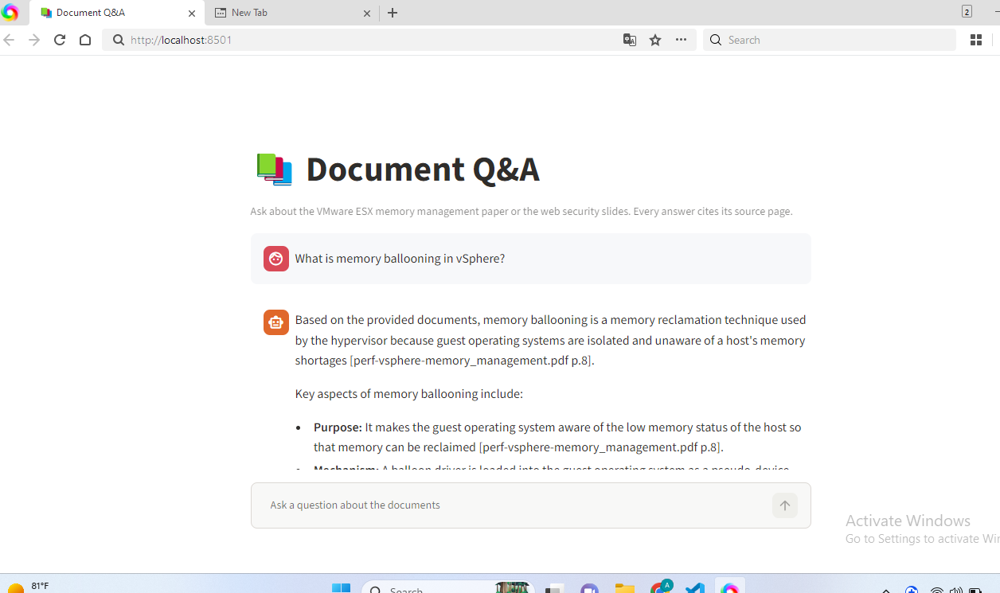
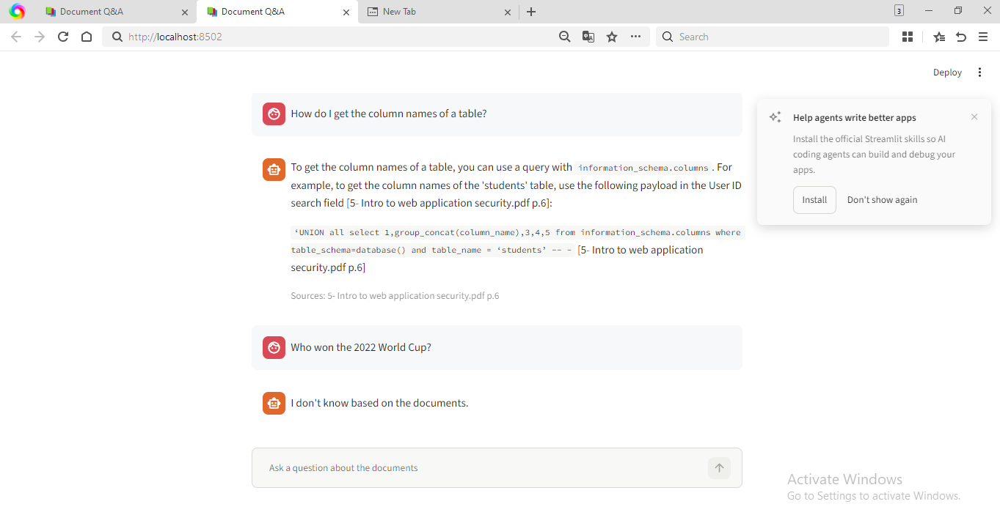
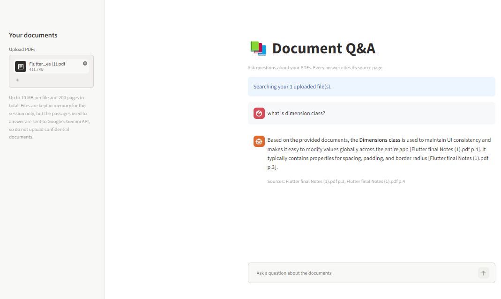

# Document Q&A: a RAG chatbot with page citations

Ask questions about your PDFs and get answers that cite the exact pages they came from. If the answer is not in the documents, the bot says so instead of guessing.





## What it does

- Reads PDFs, splits them into overlapping chunks, and stores them as vectors in a local database.
- Finds the most relevant chunks for a question using semantic search.
- Sends only those chunks to an LLM (Google Gemini) with the instruction to answer from them and cite pages.
- Shows only the pages the answer actually cites.
- Refuses to answer when the documents do not contain the answer.
- Offers two interfaces over the same core: a chat page (Streamlit) and a REST API (FastAPI).
- Lets users upload their own PDFs and ask questions about them (kept in memory for the session only).

## How it works

```
PDFs -> clean + chunk (1200 chars, 200 overlap) -> embeddings -> Chroma vector DB
                                                                      |
Question -> embedding -> top-6 similar chunks ------------------------+
                                  |
                  Gemini (answer only from these chunks, cite pages)
                                  |
                        Answer + cited pages
```

| Part | Choice | Why |
|---|---|---|
| Embeddings | `all-MiniLM-L6-v2` (sentence-transformers) | Small, free, runs on CPU |
| Vector DB | Chroma (persistent, on disk) | No server needed; `upsert` by chunk id avoids duplicates |
| LLM | Google Gemini via `google-genai` | Free tier; the model name is configurable |
| API | FastAPI | Input validation, automatic docs at `/docs` |
| UI | Streamlit | Chat interface in about 50 lines |

## Evaluation

Retrieval was tested separately from the LLM, so it is free to run and shows where failures come from.

**Test set:** 36 questions, 25 about a VMware ESX memory management white paper and 11 about web application security slides. Each question is labeled with the page that contains the answer.

**Metrics:** `hit@k` is the share of questions whose correct page appears in the top k results. MRR (mean reciprocal rank) rewards ranking the correct page higher.

| Chunk size | Chunks | hit@1 | hit@3 | hit@6 | MRR |
|---|---|---|---|---|---|
| 400 chars | 208 | 0.50 | 0.83 | 0.94 | 0.68 |
| 800 chars | 109 | 0.61 | 0.89 | 0.97 | 0.75 |
| **1200 chars** | 81 | 0.64 | 0.92 | 0.97 | 0.78 |

**Decisions from the results**

- Chunks of 400 characters lose context and perform worst.
- 800 and 1200 are close (the gap is one question), so 1200 was chosen because it matches or beats 800 on every metric.
- With top-3 retrieval a few questions were missed; with top-6 the correct page was found for 35 of 36 questions, so the chatbot retrieves 6 chunks.
- hit@1 is only about 0.64: the correct page is often in the top 6 but not first. The LLM reads all 6 chunks, so this matters less, but it is the main room for improvement.

**Failure I found by testing:** the question "What is memory ballooning in vSphere?" retrieved worse pages than "What is memory ballooning?", because the word "vSphere" appears across the whole paper and pulls the search away. This is a known weakness of pure vector search.

**Caveat:** the questions reuse wording from the documents, so these numbers are likely optimistic compared with real users, who paraphrase. Treat them as a baseline for comparing changes, not as a production accuracy figure.

Run it yourself:

```
python eval/evaluate.py
```

## Run it locally

Requires Python 3.10 to 3.12 (tested on 3.12) and a free Gemini API key from [Google AI Studio](https://aistudio.google.com).

```
git clone https://github.com/Asmara751/rag-chatbot.git
cd rag-chatbot

python -m venv venv
venv\Scripts\activate          # Windows (Mac/Linux: source venv/bin/activate)
pip install -r requirements.txt
```

1. Create a file named `.env` in the project folder with one line:
   ```
   GEMINI_API_KEY=your_key_here
   ```
2. Put your own PDFs (with selectable text) in the `data/` folder. No documents are included in this repository.
3. Index them, then start the chat page:
   ```
   python src/ingest.py
   python src/store.py
   streamlit run src/app.py
   ```

To use the API instead of the chat page:

```
python -m uvicorn api:app --app-dir src
```

Then open `http://127.0.0.1:8000/docs` and use `POST /ask` with `{"question": "your question"}`.

**Windows note:** if PyTorch fails with a missing `shm.dll` error, install the Microsoft Visual C++ Redistributable (x64).

## Project structure

```
data/            your PDFs (not committed)
src/
  ingest.py      load PDFs, clean text, chunk with page metadata
  store.py       embed chunks, store and search in Chroma
  rag.py         build the prompt, call Gemini with retries and model fallback
  api.py         FastAPI service (/ask, /health)
  app.py         Streamlit chat page
eval/
  questions.json 36 labeled questions
  evaluate.py    compares chunk sizes (hit@k, MRR)
```

## Reliability

LLM providers fail under load, and this one did during development. `rag.py` uses a 30 second timeout, short retries with waiting, and a fallback list of models, and the chat page shows a friendly message instead of a stack trace.

## Limitations

- Only PDFs with selectable text. Scanned documents need OCR, which is not built.
- English only in practice; the embedding model is trained mostly on English.
- No conversation memory: each question is answered on its own, so follow-ups like "explain that simply" do not work.
- Chunks are split page by page, so an idea that spans two pages can be cut.
- Citations are read from the model's answer text, so if the model changes its citation format the sources line can be empty.
- Pure vector search can miss rare keywords (see the "vSphere" example above).
- Tested on two documents only.
- Uploads are limited to 10 MB per file and 200 pages in total, and the text used to answer is sent to the Gemini API, so confidential documents should not be uploaded.
- Files in other languages (for example Urdu) are not supported: the embedding model is English-focused and some PDF text extraction scrambles right-to-left scripts.
- Citations use the PDF viewer's page number, which can differ from the number printed on the page when a document has a cover or front matter.

## Next steps

- Hybrid keyword + vector search, measured against the same 36 questions.
- File upload in the chat page.
- Conversation memory for follow-up questions.
- Structured (JSON) citations instead of parsing text.
